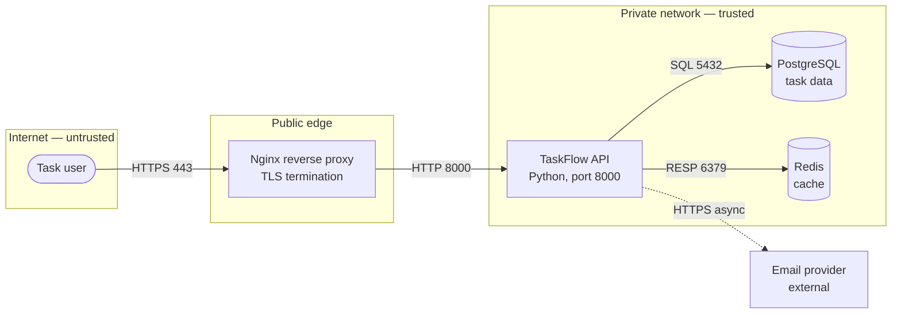

# L00-05 — Architecture diagram ও technical documentation (C4, ADR, docs-as-code)

| | |
|---|---|
| **Module** | 00 — Engineering Orientation |
| **Difficulty** | Beginner |
| **আনুমানিক সময়** | ২–৩ ঘণ্টা |
| **পূর্বশর্ত** | [L00-04 — Environments](L00-04-environments.md) |
| **Label** | — |
| **Tested** | Python code: Python 3.14-এ ৯টি test পাস; `new`, `list`, `supersede`, `lint` command চালিয়ে যাচাই; এই repository-র [architecture/adr](../architecture/adr/0001-repository-structure-and-primary-os.md)-এ `lint` পাস। Ubuntu-তে চালানো হয়নি (শুধু standard library)। |

---

## 1. এই lesson-এ যা শিখবেন

- কেন engineer-দের documentation দরকার, এবং কোন documentation সত্যিই কাজে লাগে।
- **C4 model:** Context → Container → Component → Code — চার স্তরের architecture diagram।
- একটি ভালো diagram-এর নিয়ম: legend, দিক, protocol, **trust boundary**।
- **ADR (Architecture Decision Record):** সিদ্ধান্ত কেন নেওয়া হয়েছিল তা লিখে রাখা।
- **Docs-as-code:** documentation-কে code-এর মতো Git-এ রাখা, review করা ও CI-তে যাচাই করা।
- ASCII ও **Mermaid** দিয়ে text-ভিত্তিক diagram।
- Python দিয়ে ADR তৈরি, তালিকা, supersede ও lint করার tool।

## 2. এই ধারণা কোন সমস্যার সমাধান করে

ধরুন আপনি নতুন একটি কোম্পানিতে যোগ দিলেন। প্রথম সপ্তাহেই রাত ২টায় page এলো: "Payment slow"। আপনি জানেন না:

- কোন service কোন service-কে call করে?
- Database কোথায়, cache আছে কিনা?
- কেন এখানে queue ব্যবহার করা হয়েছে, আর সেখানে হয়নি?

যিনি এগুলো জানতেন, তিনি দুই বছর আগে চাকরি ছেড়েছেন। Documentation না থাকলে:

- নতুন সদস্যের কাজ শুরু করতে মাস লাগে।
- Incident-এ সময় নষ্ট হয় system বুঝতে, সমস্যা সমাধানে নয়।
- একই আলোচনা বারবার হয় ("কেন MongoDB নয়?") কারণ আগের সিদ্ধান্তের কারণ কেউ মনে রাখে না।
- আগের সিদ্ধান্ত না বুঝে কেউ এমন পরিবর্তন করেন যা পুরোনো সমস্যা ফিরিয়ে আনে।

আবার উল্টো সমস্যাও আছে: ২০০ পাতার Word document যা কেউ পড়ে না, এবং ছয় মাসে পুরোনো হয়ে যায়। এই lesson শেখায় **কম কিন্তু সঠিক ও হালনাগাদ** documentation কীভাবে রাখতে হয়।

## 3. সহজ ভাষায় পরিচয়

### Architecture diagram কী?

একটি system-এর অংশগুলো এবং তাদের মধ্যে সম্পর্কের ছবি। উদ্দেশ্য একটি নির্দিষ্ট প্রশ্নের উত্তর দেওয়া, যেমন "user-এর request কোন পথে যায়?" বা "কোন অংশ internet থেকে দেখা যায়?"

### C4 model কী?

Simon Brown-এর তৈরি একটি পদ্ধতি, যা diagram-কে চারটি zoom স্তরে ভাগ করে — Google Maps-এ দেশ থেকে রাস্তা পর্যন্ত zoom করার মতো:

| স্তর | কী দেখায় | কার জন্য |
|---|---|---|
| **1. System Context** | আপনার system একটি box; চারপাশে user ও বাইরের system | সবাই, non-technical মানুষও |
| **2. Container** | System-এর ভেতরের চলমান অংশ: web app, API, database, queue | Engineer, operations |
| **3. Component** | একটি container-এর ভেতরের module | সেই container-এর developer |
| **4. Code** | Class, function | সাধারণত লাগে না — code নিজেই এটি |

> **সতর্কতা:** C4-এ "Container" মানে **চলমান কোনো অংশ** (application বা data store)। এটি Docker container নয় — যদিও প্রায়ই একটি C4 container একটি Docker container-এ চলে। এই দুটি অর্থ গুলিয়ে ফেলা খুব সাধারণ ভুল।

DevOps/SRE কাজে **Context ও Container স্তর** সবচেয়ে বেশি কাজে লাগে, সাথে **deployment diagram** (কোন container কোন server/cluster/region-এ চলে)।

### ADR কী?

একটি ছোট document (সাধারণত এক পাতা) যা একটি গুরুত্বপূর্ণ architecture সিদ্ধান্ত লিখে রাখে: **কোন প্রেক্ষাপটে, কোন বিকল্প বিবেচনা করে, কী সিদ্ধান্ত হলো, এবং তার ফলাফল কী।** Michael Nygard ২০১১ সালে এই ধারণা জনপ্রিয় করেন।

মূল নিয়ম: ADR **পরিবর্তন করা হয় না**। সিদ্ধান্ত বদলালে নতুন ADR লেখা হয়, এবং পুরোনোটির status হয় "Superseded by ADR-XXXX"। এভাবে সিদ্ধান্তের ইতিহাস হারায় না।

### Docs-as-code কী?

Documentation-কে code-এর মতো পরিচালনা করা:

- Plain text format (Markdown) — Git-এ diff দেখা যায়।
- Code-এর সাথে একই repository-তে।
- Pull request-এ review।
- CI-তে স্বয়ংক্রিয় যাচাই (link, format, lint)।

এই repository নিজেই docs-as-code-এর উদাহরণ: সব lesson Markdown-এ, এবং [.github/workflows/validate.yml](../.github/workflows/validate.yml) প্রতিটি পরিবর্তনে link check চালায়।

## 4. বাস্তব জীবনের উদাহরণ (analogy)

### C4 — বাড়ির নকশা

- **Context:** এলাকার মানচিত্র — আপনার বাড়ি কোথায়, পাশে রাস্তা, বাজার, স্কুল।
- **Container:** বাড়ির floor plan — কয়টি ঘর, রান্নাঘর কোথায়, পানির ট্যাংক।
- **Component:** রান্নাঘরের বিস্তারিত — চুলা, সিংক, ক্যাবিনেট।
- **Code:** প্রতিটি পাইপ ও তারের বিস্তারিত — ঠিকাদার ছাড়া কারো লাগে না।

একটি ছবিতে সব কিছু আঁকলে কিছুই বোঝা যায় না; তাই ভিন্ন স্তর।

### ADR — আদালতের রায়

আদালতের রায়ে শুধু "দোষী" লেখা থাকে না — কোন প্রমাণ, কোন যুক্তি, কোন আইনের ভিত্তিতে রায়, তাও লেখা থাকে। পরে কেউ প্রশ্ন তুললে রায় পড়ে কারণ বোঝা যায়। নতুন প্রমাণ এলে পুরোনো রায় মুছে ফেলা হয় না; নতুন রায় পুরোনোটিকে প্রতিস্থাপন করে।

### Analogy কোথায় মেলে না

- বাড়ির নকশা একবার আঁকলে বাড়ি সাধারণত বদলায় না। Software system **প্রতি সপ্তাহে বদলায়** — তাই diagram হালনাগাদ রাখার প্রক্রিয়া দরকার (docs-as-code, review-এ diagram আপডেট বাধ্যতামূলক)।
- আদালতের রায় আইনগতভাবে বাধ্যতামূলক। ADR একটি team-এর নিজস্ব সমঝোতা — পরিস্থিতি বদলালে নতুন ADR লিখে পরিবর্তন করা স্বাভাবিক ও প্রত্যাশিত।
- বাড়ির নকশায় নিরাপত্তা আলাদা স্তর নয়। Software diagram-এ **trust boundary** (কোথায় বিশ্বাসযোগ্য অংশ শেষ, অবিশ্বস্ত অংশ শুরু) আঁকা অপরিহার্য — এটি security review-এর ভিত্তি (Module 19)।

## 5. Real-world engineering scenario — পুরোনো diagram-এর ফাঁদ

**পরিস্থিতি:** একটি e-commerce কোম্পানিতে checkout হঠাৎ ধীর। On-call engineer wiki থেকে architecture diagram খুললেন।

**ঘটনার ক্রম:**

1. Diagram দেখাচ্ছে: `Web → Checkout API → PostgreSQL`।
2. Engineer ৪০ মিনিট ধরে database-এর slow query খুঁজলেন — কিছু পেলেন না।
3. শেষে log-এ দেখা গেল: Checkout API এখন একটি নতুন **Fraud Service**-কে synchronous call করে, যা আবার একটি বাইরের vendor API call করে। Vendor API ধীর।
4. Fraud Service আট মাস আগে যোগ হয়েছে। Diagram কেউ আপডেট করেনি — wiki-তে ছিল, code-এর সাথে নয়, review-এর অংশ নয়।

**ফলাফল:** ৪০ মিনিট নষ্ট, checkout বন্ধ থাকায় আর্থিক ক্ষতি।

**কী থাকলে দ্রুত হতো:**

- Code-এর পাশে Git-এ text-ভিত্তিক diagram, এবং pull request template-এ checkbox: "নতুন external dependency হলে diagram আপডেট করেছি"।
- একটি ADR: "Checkout-এ synchronous fraud check (ADR-0014)" — সাথে "Consequences: vendor ধীর হলে checkout ধীর হবে; timeout ২ সেকেন্ড ও fallback দরকার"।
- Diagram-এ প্রতিটি arrow-এ protocol ও sync/async চিহ্ন।

**Engineer কীভাবে diagnose করবেন (documentation না থাকলে):** Distributed tracing (Module 17) — একটি request কোন কোন service ছুঁয়ে যায় তা বাস্তব data থেকে দেখায়। ভালো documentation ও observability পরস্পরের পরিপূরক।

## 6. Diagram — continuous project (TaskFlow)-এর C4

### স্তর ১: System Context (ASCII)

```text
        ┌──────────────┐                          ┌───────────────────┐
        │  Task user   │                          │  Email provider   │
        │  [Person]    │                          │ [External system] │
        └──────┬───────┘                          └─────────▲─────────┘
               │ task তৈরি ও দেখা                            │ notification পাঠায়
               │ (HTTPS)                                    │ (SMTP/HTTPS API)
               ▼                                            │
        ┌──────────────────────────────────────────────────┴──┐
        │              TaskFlow system                         │
        │   [Software system — আমরা যা বানাচ্ছি]                │
        └──────────────────────────────────────────────────────┘
```

### স্তর ২: Container (Mermaid)

নিচের block GitHub ও অনেক Markdown viewer-এ ছবি হিসেবে দেখায় ([Mermaid](https://mermaid.js.org/) — text থেকে diagram তৈরির tool)। এটি Mermaid-এর নিজস্ব syntax, Python নয়:



**এই diagram-এর গুরুত্বপূর্ণ বৈশিষ্ট্য:**

- **Subgraph = trust boundary:** internet (অবিশ্বস্ত), public edge, private network। Internet থেকে সরাসরি database-এ কোনো পথ নেই — এক নজরে দেখা যায়।
- প্রতিটি arrow-এ **দিক, protocol ও port**।
- **কঠিন রেখা = synchronous**, **ডটেড রেখা = asynchronous** (email ধীর হলে user-এর request আটকায় না)।
- Database cylinder আকৃতিতে (`[( )]`) — data store চেনা যায়।

### Line-by-line ব্যাখ্যা (Mermaid)

| Line | অর্থ |
|---|---|
| `flowchart LR` | Flowchart, বাম (Left) থেকে ডানে (Right) |
| `user([Task user])` | `([ ])` = গোলাকার কোণা আকৃতি — person বোঝাতে |
| `subgraph internet["..."] ... end` | একটি group box; এখানে trust boundary |
| `api["TaskFlow API<br/>Python, port 8000"]` | Rectangle; `<br/>` = নতুন লাইন |
| `db[("PostgreSQL ...")]` | Cylinder — database |
| `A -- "label" --> B` | কঠিন arrow, label সহ |
| `A -. "label" .-> B` | ডটেড arrow |

### একটি ভালো diagram-এর checklist

- [ ] শিরোনাম ও স্তর (Context/Container/Deployment) উল্লেখ
- [ ] প্রতিটি box-এ নাম + ধরন/technology
- [ ] প্রতিটি arrow-এ দিক + উদ্দেশ্য/protocol
- [ ] Trust boundary
- [ ] Legend (রঙ, রেখা, আকৃতির অর্থ) — যদি স্পষ্ট না হয়
- [ ] একটি diagram একটি প্রশ্নের উত্তর দেয় — সব কিছু একসাথে নয়
- [ ] "শেষ হালনাগাদ" তারিখ বা Git history

## 7. গুরুত্বপূর্ণ terminology

| Term | বাংলা ব্যাখ্যা |
|---|---|
| C4 model | Context, Container, Component, Code — চার স্তরের architecture diagram পদ্ধতি |
| Container (C4) | System-এর চলমান অংশ বা data store (web app, API, DB) — Docker container নয় |
| Deployment diagram | কোন container কোন infrastructure-এ (server, cluster, region) চলে |
| Trust boundary | যে সীমা পেরোলে বিশ্বাসের মাত্রা বদলায় (যেমন internet → private network) |
| Synchronous call | Caller উত্তর না পাওয়া পর্যন্ত অপেক্ষা করে |
| Asynchronous call | Caller অপেক্ষা করে না (যেমন queue-তে message দিয়ে এগিয়ে যায়) |
| ADR | একটি architecture সিদ্ধান্ত, তার প্রেক্ষাপট, বিকল্প ও ফলাফলের ছোট লিখিত রেকর্ড |
| Superseded | পরবর্তী সিদ্ধান্ত দিয়ে প্রতিস্থাপিত (মুছে ফেলা নয়) |
| Docs-as-code | Documentation-কে code-এর মতো Git, review ও CI দিয়ে পরিচালনা |
| Diagram-as-code | Text থেকে diagram তৈরি (Mermaid, PlantUML, Structurizr) |
| Runbook | নির্দিষ্ট operational কাজের ধাপে ধাপে নির্দেশিকা (Module 18) |

## 8. ভেতরে কীভাবে কাজ করে

### 8.1 Engineering team-এ কোন documentation দরকার

Documentation-এর ধরন উদ্দেশ্য অনুযায়ী আলাদা (Diátaxis framework এভাবে চার ভাগ করে):

| ধরন | প্রশ্ন | উদাহরণ (এই repository-তে) |
|---|---|---|
| **Tutorial** | "আমি শিখতে চাই" | প্রতিটি lesson |
| **How-to guide** | "আমি X কাজটি করতে চাই" | [runbooks/](../runbooks/README.md), lab |
| **Reference** | "X-এর সঠিক তথ্য কী?" | [GLOSSARY.md](../GLOSSARY.md), [reference/](../reference/README.md) |
| **Explanation** | "কেন এমন?" | ADR, architecture document |

একটি document-এ চারটি মিশিয়ে ফেললে কোনোটাই ভালো হয় না। যেমন runbook-এ ইতিহাস ও তত্ত্ব রাখলে রাত ২টায় দরকারি command খুঁজে পাওয়া যায় না।

**DevOps/SRE team-এর ন্যূনতম documentation:**

1. Service README: কী করে, কীভাবে চালাতে হয়, owner কে।
2. Architecture diagram (Context + Container + Deployment)।
3. ADR — গুরুত্বপূর্ণ সিদ্ধান্তের।
4. Runbook — প্রতিটি alert-এর জন্য।
5. Postmortem — incident থেকে শিক্ষা।

### 8.2 কোন সিদ্ধান্তে ADR লিখবেন

সব সিদ্ধান্তে নয়। ADR লিখুন যখন সিদ্ধান্তটি:

- পরে বদলানো **ব্যয়বহুল** (database, programming language, cloud provider, monolith বনাম microservice)।
- একাধিক team-কে **প্রভাবিত** করে।
- নিয়ে **বিতর্ক** হয়েছে বা ভবিষ্যতে প্রশ্ন উঠবে ("কেন Kubernetes নয়?")।
- একটি **ঝুঁকি** সচেতনভাবে গ্রহণ করে।

ADR লেখার দরকার নেই: variable-এর নাম, ছোট library-র পছন্দ যা সহজে বদলানো যায়।

### 8.3 ADR-এর জীবনচক্র

```text
  Proposed ──review──► Accepted ──(সময় যায়, পরিস্থিতি বদলায়)──► Superseded by ADR-NNNN
                                    └──────────────────────────► Deprecated (আর প্রাসঙ্গিক নয়)
```

ADR-এর **মূল text** গৃহীত হওয়ার পরে বদলানো হয় না; শুধু status লাইন বদলায়। কারণ ADR হলো "সেই সময়ে আমরা কী জানতাম ও ভাবতাম" তার সৎ রেকর্ড।

### 8.4 Docs-as-code pipeline

```text
  developer ──► Markdown + Mermaid (code-এর সাথে একই PR-এ)
                    │
                    ▼
            Pull request review ── "diagram আপডেট হয়েছে?" checklist
                    │
                    ▼
            CI: link check · ADR lint · Markdown format  ── fail হলে merge বন্ধ
                    │
                    ▼
            merge ──► documentation site / GitHub-এ rendered view
```

এই lesson-এর `adr.py lint` হলো এই pipeline-এর একটি CI step-এর উদাহরণ।

## 9. Practical demonstration

### ধাপ ১ — Example ADR পড়ুন

Folder: [`code/L00-05/example-adr/`](code/L00-05/example-adr/0001-run-taskflow-api-as-a-single-service.md)

```bash
cd 00-orientation/code/L00-05
ls example-adr/
cat example-adr/0001-run-taskflow-api-as-a-single-service.md
```

লক্ষ্য করুন ADR-0001 microservice **না** করার সিদ্ধান্ত — এবং কখন পুনর্বিবেচনা করা হবে তাও লেখা। "কী করছি না এবং কেন" লেখাও সমান গুরুত্বপূর্ণ।

### ধাপ ২ — ADR তালিকা ও lint

```bash
python3 adr.py --dir example-adr list
python3 adr.py --dir example-adr lint
echo "exit code: $?"
```

`list` ও `lint` শুধু file পড়ে, কিছু লেখে না।

**এই repository-তে চালিয়ে পাওয়া আসল output:**

```text
ADR-0001  Accepted                    Run TaskFlow API as a single service
ADR-0002  Accepted                    Use PostgreSQL for task storage
2 ADR(s), 0 problem(s)
exit code: 0
```

### ধাপ ৩ — নতুন ADR তৈরি ও supersede (temporary directory-তে)

`new` ও `supersede` **file তৈরি ও পরিবর্তন করে**, তাই practice-এর জন্য একটি অস্থায়ী directory ব্যবহার করুন:

```bash
ADR_DIR=$(mktemp -d)        # /tmp-এ একটি নতুন খালি directory তৈরি, path variable-এ রাখা
echo "$ADR_DIR"

python3 adr.py --dir "$ADR_DIR" new "Use Nginx as reverse proxy"
python3 adr.py --dir "$ADR_DIR" new "Expose API directly on port 8000"
python3 adr.py --dir "$ADR_DIR" supersede 2 "Put API behind Nginx only"
python3 adr.py --dir "$ADR_DIR" list
python3 adr.py --dir "$ADR_DIR" lint
```

| Command | কী পড়ে | কী লেখে / বদলায় |
|---|---|---|
| `mktemp -d` | — | `/tmp`-এ নতুন খালি directory |
| `new` | বিদ্যমান ADR নম্বর | নতুন `NNNN-slug.md` file (বিদ্যমান file কখনো overwrite করে না) |
| `supersede 2 ...` | ADR-0002 | নতুন ADR-0003 তৈরি + ADR-0002-এর **শুধু Status লাইন** বদলায় |
| `list`, `lint` | সব ADR | কিছু না |

**এই repository-তে চালিয়ে পাওয়া আসল output** (temporary path আপনার machine-এ ভিন্ন হবে):

```text
created /tmp/tmp.XXXXXXXX/0001-use-nginx-as-reverse-proxy.md
created /tmp/tmp.XXXXXXXX/0002-expose-api-directly-on-port-8000.md
created /tmp/tmp.XXXXXXXX/0003-put-api-behind-nginx-only.md
ADR-0001  Proposed                    Use Nginx as reverse proxy
ADR-0002  Superseded by ADR-0003      Expose API directly on port 8000
ADR-0003  Proposed                    Put API behind Nginx only
3 ADR(s), 0 problem(s)
```

নতুন ADR খুলে দেখুন — template-এ section আছে, আপনাকে বিষয়বস্তু লিখতে হবে:

```bash
cat "$ADR_DIR/0003-put-api-behind-nginx-only.md"
```

শেষে পরিষ্কার করুন:

```bash
rm -r "$ADR_DIR"     # শুধু এই temporary directory মোছে
unset ADR_DIR
```

> ⚠️ `rm -r`-এর আগে `echo "$ADR_DIR"` দিয়ে নিশ্চিত হোন path-টি `/tmp/...`। Variable খালি থাকলে command ভুল জায়গায় চলতে পারে। Module 04-এ শিখবেন কীভাবে script-এ এই ঝুঁকি আটকাতে হয় (`${VAR:?}`)।

### ধাপ ৪ — এই repository-র নিজের ADR lint করুন

```bash
cd ../../..        # repository root-এ ফেরা
python3 00-orientation/code/L00-05/adr.py --dir architecture/adr lint
```

**আসল output:** `1 ADR(s), 0 problem(s)` — [ADR-0001](../architecture/adr/0001-repository-structure-and-primary-os.md) এই repository-র structure ও Ubuntu-কে primary OS করার সিদ্ধান্ত।

### ধাপ ৫ — Mermaid diagram দেখুন

এই lesson file GitHub-এ খুললে Section 6-এর Mermaid block ছবি হিসেবে দেখাবে। Local-এ দেখার উপায়:

- VS Code-এ Markdown preview (Mermaid-এর জন্য extension লাগতে পারে)।
- https://mermaid.live — browser-এ code paste করে সঙ্গে সঙ্গে ছবি দেখা।

> **সতর্কতা:** Mermaid live editor একটি বাইরের website। Company-র গোপন architecture (internal hostname, IP) সেখানে paste করার আগে নিজের প্রতিষ্ঠানের নীতি দেখুন।

### ধাপ ৬ — Test

```bash
cd 00-orientation/code/L00-05
python3 -m unittest -v
```

[`test_adr.py`](code/L00-05/test_adr.py)-এর ৯টি test: slug তৈরি, শুধু বাংলা title প্রত্যাখ্যান (filename ASCII রাখতে), ক্রমিক নম্বর, বিদ্যমান file overwrite হয় না, supersede-এ পুরোনো status বদলায়, lint-এ ভুল নম্বর/status/section/filename ধরা পড়ে, example ADR পরিষ্কার, ও CLI exit code।

## 10. Code-এর ব্যাখ্যা

File: [`code/L00-05/adr.py`](code/L00-05/adr.py) · Python 3.10+ · Dependency: নেই

| অংশ | কী করে | কেন এভাবে |
|---|---|---|
| `FILENAME_RE = r"^(\d{4})-([a-z0-9-]+)\.md$"` | `0001-use-postgresql.md` format যাচাই | চার অঙ্কের নম্বর হলে `ls`-এ সঠিক ক্রমে সাজে (0002 আগে 0010-এর) |
| `slugify()` | Title → ASCII lowercase-hyphen | Filename-এ space, বিশেষ অক্ষর বা non-ASCII অনেক tool ও OS-এ সমস্যা করে |
| `next_number()` | সর্বোচ্চ নম্বর + ১ | মাঝের নম্বর খালি থাকলেও (কেউ file মুছলে) নম্বর পুনর্ব্যবহার হয় না |
| `path.open("x")` | শুধু নতুন file তৈরি; থাকলে `FileExistsError` | **নিরাপদ default:** কারো লেখা ADR কখনো ভুল করে মুছে যাবে না |
| `newline="\n"` | Line ending সবসময় LF | Windows-এ চালালেও Linux-এর মতো file; Git-এ অপ্রয়োজনীয় diff হয় না |
| `supersede()` | `STATUS_RE.sub(..., count=1)` | ADR-এর বাকি text অক্ষত — শুধু status বদলায় (ADR immutability নীতি) |
| `lint()` | নম্বর, heading, status, section, filename যাচাই | Docs-as-code: মানুষের review-এর আগে যন্ত্র নিয়ম যাচাই করে |
| `VALID_STATUS` | শুধু নির্দিষ্ট status | "Done", "OK" জাতীয় অস্পষ্ট status আটকায় |
| Exit code `0`/`1`/`2` | ঠিক / lint সমস্যা / input error | CI-তে সরাসরি gate হিসেবে |

### Python কেন এখানে, আর কোথায় নয়

- Diagram-এর জন্য **Mermaid-এর নিজস্ব syntax** দরকার — Python দিয়ে লেখা হয় না (Python দিয়ে Mermaid text তৈরি করা যায়, তবে সাধারণত হাতে লেখাই সহজ)।
- ADR নিজে Markdown — মানুষের পড়ার জন্য।
- Python এখানে **automation ও যাচাইয়ের** কাজ করে: নম্বর দেওয়া, template, lint। বাস্তবে `adr-tools` (Bash) বা `log4brains` জাতীয় tool-ও আছে — নিজে একটি ছোট tool লিখে ধারণাটি ভেতর থেকে বুঝলেন।

## 11. প্রত্যাশিত ফল ও যাচাই

| Command | প্রত্যাশিত |
|---|---|
| `adr.py --dir example-adr lint` | `2 ADR(s), 0 problem(s)`, exit 0 |
| `adr.py --dir <tmp> new "!!!"` | `error: title must contain at least one ASCII letter or digit`, exit 2 |
| ভাঙা ADR-এ `lint` | প্রতিটি সমস্যা `FAIL` লাইনে, exit 1 |
| `python3 -m unittest -v` | `Ran 9 tests`, `OK` |

## 12. সাধারণ ভুল ও troubleshooting

| Symptom | সম্ভাব্য কারণ | কীভাবে নিশ্চিত হবেন | সমাধান |
|---|---|---|---|
| `invalid status 'Accepted.'` | শেষে বাড়তি বিরামচিহ্ন | Status লাইন দেখুন | হুবহু `Accepted` লিখুন |
| `missing section '## Decision'` | Heading বানান বা স্তর ভুল (`### Decision`) | `grep -n "^#" file.md` | দুটি `#` দিয়ে section |
| `heading says ADR-0003` | File copy করে নম্বর বদলাননি | File নাম ও প্রথম লাইন তুলনা | Heading-এর নম্বর ঠিক করুন |
| `error: title must contain...` | Title শুধু বাংলায় | — | Title-এ English শব্দ রাখুন; বাংলা ব্যাখ্যা ADR-এর ভেতরে লিখুন |
| Mermaid ছবি দেখায় না | Viewer Mermaid সমর্থন করে না, বা syntax ভুল | mermaid.live-এ paste করে error দেখুন | Syntax ঠিক করুন; label-এ বিশেষ অক্ষর থাকলে `"..."` quote দিন |

### ধারণাগত সাধারণ ভুল

- **এক diagram-এ সব কিছু** — শত box, কেউ বোঝে না। একটি diagram = একটি প্রশ্ন।
- **Arrow-এ label নেই** — "API → DB" কী পাঠায়, কোন দিকে কে শুরু করে, বোঝা যায় না।
- **Image file (PNG) হিসেবে diagram রাখা, source ছাড়া** — পরে কেউ সম্পাদনা করতে পারে না। Text source রাখুন।
- **ADR পরে সম্পাদনা করে সিদ্ধান্ত বদলানো** — ইতিহাস হারায়। নতুন ADR দিয়ে supersede করুন।
- **শুধু "কী" লেখা, "কেন" নয়** — "আমরা PostgreSQL ব্যবহার করি" তথ্যটি code দেখেই জানা যায়; মূল্য হলো **কারণ ও বিকল্প**।

## 13. Security, performance ও cost বিবেচনা

- **Security:**
  - Diagram-এ trust boundary আঁকা threat modeling-এর প্রথম ধাপ (Module 19)।
  - Public repository-তে architecture diagram-এ internal IP, hostname, credential বা security দুর্বলতার বিবরণ রাখবেন না।
  - বাইরের online diagram tool-এ গোপন architecture paste করার আগে অনুমতি নিন।
- **Performance:** Diagram-এ sync/async চিহ্ন performance বিশ্লেষণে সাহায্য করে: synchronous chain যত লম্বা, latency তত যোগ হয় এবং একটি ধীর অংশ পুরো chain ধীর করে (Section 5)।
- **Cost:** ভালো documentation নতুন সদস্যের onboarding ও incident-এর সময় কমায় — সরাসরি engineering সময় বাঁচায়। ADR-এর "Consequences"-এ খরচের প্রভাব লিখুন (যেমন "managed database: মাসে আনুমানিক খরচ বাড়বে, কিন্তু backup-এর কাজ কমবে")।

## 14. Hands-on exercise

1. **নিজের ADR:** `ADR_DIR=$(mktemp -d)` নিয়ে একটি ADR লিখুন: "Use systemd to run TaskFlow API on a single VM" (Module 06-এ এটাই করবেন)। Context, অন্তত দুটি option (systemd, Docker), Decision ও Consequences পূরণ করুন। `lint` চালান।
2. **Supersede:** পরে কল্পনা করুন team Docker-এ যাচ্ছে। `supersede` দিয়ে নতুন ADR তৈরি করুন এবং পুরোনোটির status দেখুন।
3. **Mermaid পরিবর্তন:** Section 6-এর Container diagram-এ একটি **background worker** ও **message queue** যোগ করুন — API queue-তে কাজ দেয় (async), worker queue থেকে নিয়ে email পাঠায়। mermaid.live-এ যাচাই করুন।
4. **Code পরিবর্তন:** `adr.py`-তে `--status` filter যোগ করুন (`list --status Accepted`)। একটি test লিখুন।
5. **Lint নিয়ম যোগ:** "Options considered" section-এ কমপক্ষে দুটি বিকল্প (`1.` ও `2.` দিয়ে শুরু লাইন) আছে কিনা যাচাইয়ের নিয়ম যোগ করুন। Example ADR-গুলো কি পাস করে?

## 15. Mini-project — নিজের WordPress site-এর architecture documentation

`~/devops-notebook/L00-05-wordpress-architecture.md`-এ:

1. **Context diagram** (ASCII বা Mermaid): visitor, admin, WordPress site, payment gateway, email service, CDN (যা প্রযোজ্য)।
2. **Container diagram:** web server (Nginx/Apache), PHP-FPM, MySQL/MariaDB, object cache, file storage — প্রতিটি arrow-এ protocol ও port; trust boundary।
3. **তিনটি ADR** (`adr.py` দিয়ে তৈরি): যেমন "Use managed hosting vs VPS", "Use a caching plugin vs Nginx FastCGI cache", "Store uploads locally vs object storage"।
4. `adr.py lint` পাস করান।
5. নিজেকে প্রশ্ন করুন: আজ রাত ২টায় site down হলে এই documentation কি অন্য কাউকে সাহায্য করবে? না হলে কী বাদ পড়েছে?

## 16. Interview প্রশ্ন

1. C4 model-এর চারটি স্তর কী? DevOps/SRE কাজে কোনগুলো সবচেয়ে কাজে লাগে?
2. C4-এর "container" ও Docker container-এর পার্থক্য কী?
3. ADR কী এবং কেন লিখবেন? ADR কি পরে সম্পাদনা করা উচিত?
4. কোন সিদ্ধান্তে ADR লিখবেন, কোনটিতে নয়?
5. Docs-as-code-এর সুবিধা কী? Documentation কীভাবে হালনাগাদ রাখবেন?
6. একটি ভালো architecture diagram-এ কী কী থাকা উচিত?
7. Diagram-এ trust boundary কেন গুরুত্বপূর্ণ?

## 17. Self-assessment প্রশ্ন

1. C4-এর চারটি স্তর বাড়ির নকশার analogy দিয়ে ব্যাখ্যা করুন, তারপর analogy কোথায় মেলে না বলুন।
2. Section 5-এর incident-এ কোন তিনটি documentation অভ্যাস ৪০ মিনিট বাঁচাত?
3. Mermaid diagram-এ API থেকে email-এর arrow ডটেড কেন? Synchronous হলে কী ঝুঁকি?
4. `adr.py`-তে file তৈরিতে `"x"` mode কেন ব্যবহার হয়েছে?
5. ADR supersede করার সময় পুরোনো ADR মুছে ফেলা হয় না কেন?
6. Diátaxis-এর চার ধরনের documentation কী? Runbook কোন ধরনে পড়ে এবং কেন সেখানে দীর্ঘ তত্ত্ব রাখা উচিত নয়?

## 18. সংক্ষিপ্ত সারাংশ

- Documentation-এর লক্ষ্য: নতুন মানুষ ও রাত ২টার on-call engineer যেন দ্রুত system বোঝেন। কম, সঠিক, হালনাগাদ — বিশাল ও পুরোনো নয়।
- **C4 model:** Context → Container → Component → Code। C4 container ≠ Docker container।
- ভালো diagram: একটি প্রশ্নের উত্তর, labeled arrow, protocol, sync/async, **trust boundary**।
- **ADR:** প্রেক্ষাপট, বিকল্প, সিদ্ধান্ত, ফলাফল। গৃহীত হলে text বদলায় না; নতুন ADR দিয়ে **supersede**।
- **Docs-as-code:** Markdown + text diagram (Mermaid) Git-এ, PR-এ review, CI-তে lint ও link check।

## 19. Completion checklist

- [ ] Example ADR দুটি পড়েছি এবং `list` ও `lint` চালিয়েছি
- [ ] Temporary directory-তে `new` ও `supersede` চালিয়ে ফল দেখেছি, পরে পরিষ্কার করেছি
- [ ] এই repository-র ADR-0001 lint করেছি
- [ ] Mermaid Container diagram rendered অবস্থায় দেখেছি
- [ ] `python3 -m unittest -v` চালিয়ে ৯টি test পাস দেখেছি
- [ ] Exercise ১ ও ৩ শেষ করেছি
- [ ] Mini-project: নিজের WordPress site-এর Context ও Container diagram এবং তিনটি ADR
- [ ] [PROGRESS.md](PROGRESS.md)-এ learner status আপডেট করেছি

## 20. Official documentation ও further reading

- C4 model (official): https://c4model.com/
- Mermaid documentation: https://mermaid.js.org/
- Michael Nygard, "Documenting Architecture Decisions" (মূল ADR প্রবন্ধ): https://cognitect.com/blog/2011/11/15/documenting-architecture-decisions
- ADR community resources: https://adr.github.io/
- Diátaxis documentation framework: https://diataxis.fr/
- GitHub-এ Mermaid diagram: https://docs.github.com/en/get-started/writing-on-github/working-with-advanced-formatting/creating-diagrams
- এই repository-র template: [templates/adr-template.md](../templates/adr-template.md), [architecture/](../architecture/README.md)

---

**পরের lesson:** L00-06 — Experiment, log, measurement ও incident analysis দিয়ে শেখা
