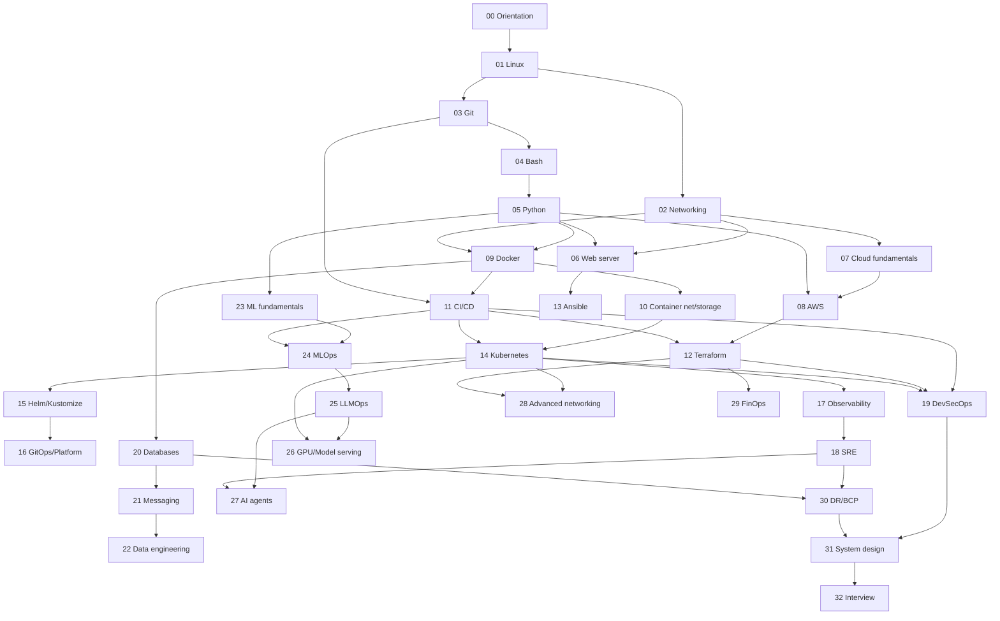

# CURRICULUM MAP — সব lesson-এর ক্রম ও dependency

## নিয়ম

- **Lesson ID:** `LMM-NN` — `MM` = module নম্বর, `NN` = module-এর ভেতরে ক্রম।
- **File path:** `<module-folder>/LMM-NN-<slug>.md` (যেমন `00-orientation/L00-01-what-is-devops.md`)।
- **Lesson code:** `<module-folder>/code/LMM-NN/`।
- **Dependency:** একটি lesson-এর পূর্বশর্ত = একই module-এর আগের lesson + module-এর পূর্বশর্ত module। আলাদা cross-module পূর্বশর্ত থাকলে "Needs" কলামে লেখা।
- **Level:** B = Beginner, I = Intermediate, A = Advanced।
- **Label:** 🖥️ VM · 💰 COST · 🎮 GPU · 🧠 16GB · 🔗 MULTI · 🎩 Fedora-তে আলাদা অংশ উল্লেখযোগ্য।
- Lesson-এর অবস্থা (status) দেখুন [PROGRESS.md](PROGRESS.md)-এ।

## Module dependency graph

| Module | পূর্বশর্ত module |
|---|---|
| 00 | — |
| 01 | 00 |
| 02 | 01 |
| 03 | 01 |
| 04 | 01, 03 |
| 05 | 04 |
| 06 | 02, 05 |
| 07 | 02 |
| 08 | 05, 07 |
| 09 | 01, 02, 05 |
| 10 | 09 |
| 11 | 03, 09 |
| 12 | 08, 11 |
| 13 | 06 |
| 14 | 10, 11 |
| 15 | 14 |
| 16 | 11, 15 |
| 17 | 14 |
| 18 | 17 |
| 19 | 11, 12, 14 |
| 20 | 09 |
| 21 | 20 |
| 22 | 05, 21 |
| 23 | 05 |
| 24 | 09, 11, 23 |
| 25 | 24 |
| 26 | 14, 25 |
| 27 | 18, 25 |
| 28 | 08, 12, 14 |
| 29 | 08, 12 |
| 30 | 18, 20 |
| 31 | 18, 19, 20, 30 |
| 32 | 31 |

---

## Stage 0 — Engineering Orientation

### Module 00 — `00-orientation/`

| ID | Lesson | Level | Label / Needs |
|---|---|---|---|
| L00-01 | DevOps আসলে কী: culture, feedback loop ও DORA metrics | B | |
| L00-02 | Engineering roles: DevOps, SRE, Platform, Cloud, Security, MLOps, AI Infra | B | |
| L00-03 | SDLC, Agile, Scrum, Kanban ও release management | B | |
| L00-04 | Environments: development, testing, staging, production | B | |
| L00-05 | Architecture diagram ও technical documentation (C4, ADR, docs-as-code) | B | |
| L00-06 | Experiment, log, measurement ও incident analysis দিয়ে শেখা | B | |
| L00-07 | Lab environment setup: Ubuntu (VM/native/WSL2), Python venv, notebook | B | 🖥️ |

## Stage 1 — Linux and Operating Systems

### Module 01 — `01-linux-systems/`

| ID | Lesson | Level | Label / Needs |
|---|---|---|---|
| L01-01 | Linux architecture: kernel space, user space ও system call | B | |
| L01-02 | Package management: apt, dpkg, repository (Fedora-তে dnf, rpm) | B | 🎩 |
| L01-03 | Filesystem hierarchy, mount point, inode ও link | B | |
| L01-04 | Users, groups, ownership ও permission | B | |
| L01-05 | ACL, sudo ও least privilege | B | |
| L01-06 | Shell fundamentals: quoting, expansion, environment variable, exit code | B | |
| L01-07 | Pipe, redirection, grep, sed, awk, find, xargs, jq | B | |
| L01-08 | Process, thread, process state ও signal | I | |
| L01-09 | CPU scheduling, virtual memory, swap ও OOM | I | |
| L01-10 | systemd: unit, service, target ও journald | I | |
| L01-11 | cron বনাম systemd timer | B | |
| L01-12 | Storage: partition, filesystem, LVM, disk usage | I | 🖥️ ⚠️ |
| L01-13 | SSH, SSH key, agent forwarding ও নিরাপদ remote access | I | |
| L01-14 | Log, debugging ও resource inspection (journalctl, strace, lsof) | I | |
| L01-15 | Performance profiling: top, vmstat, iostat, pidstat, perf | I | |
| L01-16 | Namespace, cgroup ও Linux capability | A | |
| L01-17 | Mandatory access control: AppArmor (Ubuntu) ও SELinux (Fedora) | A | 🖥️ 🎩 |
| L01-18 | Software update, boot process ও system recovery | I | 🖥️ |

## Stage 2 — Computer Networking

### Module 02 — `02-computer-networking/`

| ID | Lesson | Level | Label / Needs |
|---|---|---|---|
| L02-01 | OSI ও TCP/IP model | B | |
| L02-02 | Ethernet, MAC address, ARP, switching ও VLAN | B | |
| L02-03 | IPv4, IPv6, CIDR ও subnetting | B | |
| L02-04 | Routing table, gateway ও NAT | I | |
| L02-05 | TCP, UDP, port, socket ও connection state | I | |
| L02-06 | DNS: recursive resolver, authoritative server ও caching | I | |
| L02-07 | HTTP/1.1, HTTP/2 ও HTTP/3 | I | |
| L02-08 | TLS, certificate ও HTTPS | I | |
| L02-09 | DHCP, ICMP, MTU ও path MTU discovery | I | |
| L02-10 | Firewall: nftables, ufw (Fedora-তে firewalld), security group ও NACL | I | 🎩 |
| L02-11 | SSH tunnel, VPN, WireGuard ও zero-trust connectivity | A | 🔗 |
| L02-12 | Load balancing ও reverse proxy: L4 বনাম L7 | I | |
| L02-13 | Network namespace, veth pair ও bridge | A | |
| L02-14 | Cloud networking concept: VPC, subnet, routing, peering | I | |
| L02-15 | tcpdump ও Wireshark দিয়ে packet inspection | I | |
| L02-16 | Troubleshooting toolkit: dig, curl, ss, ip, traceroute, mtr | I | |
| L02-17 | Browser থেকে database পর্যন্ত: একটি request-এর পূর্ণ যাত্রা | I | |

## Stage 3 — Git, Bash, Python and Automation

### Module 03 — `03-git-and-collaboration/`

| ID | Lesson | Level | Label / Needs |
|---|---|---|---|
| L03-01 | Git internals: object, commit, tree, ref | I | |
| L03-02 | Branch, merge ও rebase | B | |
| L03-03 | Remote, tag ও semantic versioning | B | |
| L03-04 | Pull request, code review, protected branch, CODEOWNERS | B | |
| L03-05 | Git recovery: reflog, reset, revert, bisect | I | |
| L03-06 | GitHub Actions fundamentals | B | |

### Module 04 — `04-bash-and-shell-automation/`

| ID | Lesson | Level | Label / Needs |
|---|---|---|---|
| L04-01 | Bash script-এর গঠন ও strict mode (এবং এর সীমাবদ্ধতা) | B | |
| L04-02 | Variable, array ও parameter expansion | B | |
| L04-03 | Function ও reusable script | B | |
| L04-04 | Error handling ও trap | I | |
| L04-05 | Argument parsing, getopts, usage ও logging | I | |
| L04-06 | Safe ও idempotent script: locking, temp file, dry-run | I | |
| L04-07 | ShellCheck ও bats দিয়ে testing | I | |
| L04-08 | কখন Bash, কখন Python | B | |

### Module 05 — `05-python-for-infrastructure/`

| ID | Lesson | Level | Label / Needs |
|---|---|---|---|
| L05-01 | Python environment: version, venv, pip, pyproject | B | |
| L05-02 | Ops-এর জন্য Python fundamentals ও type hint | B | |
| L05-03 | File, directory ও pathlib | B | |
| L05-04 | subprocess নিরাপদভাবে চালানো | I | |
| L05-05 | JSON, YAML ও configuration processing | B | |
| L05-06 | HTTP client ও API: timeout, retry, error handling | I | |
| L05-07 | Logging, structured log ও exception | I | |
| L05-08 | argparse দিয়ে CLI tool | B | |
| L05-09 | pytest দিয়ে unit ও integration testing | I | |
| L05-10 | Secret ও configuration: env var, .env, secret manager | I | |
| L05-11 | Log analysis tool তৈরি | I | |
| L05-12 | Health check ও backup verification tool | I | |
| L05-13 | Continuous project শুরু: প্রথম Python web API | I | |

## Stage 4 — Web Infrastructure and Cloud Fundamentals

### Module 06 — `06-web-server-and-reverse-proxy/`

| ID | Lesson | Level | Label / Needs |
|---|---|---|---|
| L06-01 | DNS record ও domain configuration | B | |
| L06-02 | Nginx architecture: master, worker, event loop | I | |
| L06-03 | Nginx server block (virtual host) | B | |
| L06-04 | Reverse proxy ও upstream | I | Needs L05-13 |
| L06-05 | Application process, port, unix socket ও systemd service | I | |
| L06-06 | Nginx caching ও compression | I | |
| L06-07 | Nginx-এ TLS ও certificate | I | |
| L06-08 | Linux server hardening | I | 🖥️ |
| L06-09 | PHP-FPM ও WordPress deployment | I | |

### Module 07 — `07-cloud-fundamentals/`

| ID | Lesson | Level | Label / Needs |
|---|---|---|---|
| L07-01 | Virtualization ও hypervisor | B | |
| L07-02 | IaaS, PaaS, SaaS ও shared responsibility model | B | |
| L07-03 | Region, availability zone ও fault domain | B | |
| L07-04 | Public বনাম private networking | B | |
| L07-05 | IAM, identity ও least privilege | I | |
| L07-06 | Cloud cost model, budget, tagging ও cleanup | B | |

### Module 08 — `08-aws-core-services/`

| ID | Lesson | Level | Label / Needs |
|---|---|---|---|
| L08-01 | AWS account safety: root user, MFA, budget alert | B | 💰 |
| L08-02 | AWS CLI, profile, temporary credential ও boto3 | I | 💰 |
| L08-03 | IAM: policy, role, instance profile | I | 💰 |
| L08-04 | VPC design: subnet, route table, gateway | I | 💰 |
| L08-05 | Security group ও network ACL | I | 💰 |
| L08-06 | EC2 | I | 💰 |
| L08-07 | EBS ও EFS | I | 💰 |
| L08-08 | S3 | I | 💰 |
| L08-09 | Elastic Load Balancing | I | 💰 |
| L08-10 | Route 53 | I | 💰 |
| L08-11 | CloudWatch | I | 💰 |
| L08-12 | Tagging, Cost Explorer ও resource cleanup automation | I | 💰 |

## Stage 5 — Docker and Containers

### Module 09 — `09-docker-and-containers/`

| ID | Lesson | Level | Label / Needs |
|---|---|---|---|
| L09-01 | Container বনাম virtual machine | B | |
| L09-02 | Docker architecture: daemon, containerd, runc, OCI | I | |
| L09-03 | Image, layer ও registry | B | |
| L09-04 | Dockerfile fundamentals | B | |
| L09-05 | Multi-stage build ও image optimization | I | |
| L09-06 | Tag, immutable digest ও image provenance | I | |
| L09-07 | Environment variable, configuration ও secret | I | |
| L09-08 | Health check, restart policy ও resource limit | I | |
| L09-09 | Container logging ও debugging | I | |
| L09-10 | Container security: non-root, capability, read-only filesystem | I | |
| L09-11 | Container registry ও image scanning | I | |
| L09-12 | Docker Compose | B | |
| L09-13 | Multi-container application: frontend, backend, database, reverse proxy | I | Needs L05-13 |
| L09-14 | WordPress/PHP stack in Docker Compose | I | |

### Module 10 — `10-container-networking-and-storage/`

| ID | Lesson | Level | Label / Needs |
|---|---|---|---|
| L10-01 | Bridge, host ও none network | I | |
| L10-02 | Container DNS ও service discovery | I | |
| L10-03 | Port publishing এবং iptables/nftables-এর ভূমিকা | A | |
| L10-04 | Overlay network-এর পরিচিতি | A | 🔗 |
| L10-05 | Volume, bind mount ও tmpfs | I | |
| L10-06 | Container data persistence ও backup | I | |
| L10-07 | Rootless container ও Podman | I | 🎩 |

## Stage 6 — CI/CD and Release Engineering

### Module 11 — `11-ci-cd-and-release-engineering/`

| ID | Lesson | Level | Label / Needs |
|---|---|---|---|
| L11-01 | Continuous Integration, Delivery ও Deployment | B | |
| L11-02 | GitHub Actions: trigger, job, step, runner | I | |
| L11-03 | Build ও test stage | I | |
| L11-04 | Dependency caching ও build optimization | I | |
| L11-05 | Artifact versioning ও immutable artifact | I | |
| L11-06 | Container registry-তে publish | I | |
| L11-07 | Environment protection ও manual approval | I | |
| L11-08 | Secret management ও OIDC | A | |
| L11-09 | Deployment strategy: rolling, blue-green, canary, recreate | I | |
| L11-10 | Database migration strategy | A | |
| L11-11 | Smoke test, release verification ও rollback | I | |
| L11-12 | Supply-chain security ও SBOM | A | |
| L11-13 | Reusable workflow, notification ও audit trail | I | |
| L11-14 | End-to-end pipeline: build → test → scan → publish → deploy → verify | A | |

## Stage 7 — Infrastructure as Code and Configuration Management

### Module 12 — `12-terraform-and-iac/`

| ID | Lesson | Level | Label / Needs |
|---|---|---|---|
| L12-01 | Infrastructure as Code কেন | B | |
| L12-02 | Terraform workflow: init, plan, apply (local provider দিয়ে) | B | |
| L12-03 | Provider, resource, data source, variable, output | I | |
| L12-04 | Terraform state ভেতর থেকে | I | |
| L12-05 | Remote state, locking ও state security | A | 💰 |
| L12-06 | Resource dependency ও lifecycle | I | |
| L12-07 | Module ও module versioning | I | |
| L12-08 | Environment ও workspace | I | |
| L12-09 | Testing ও validation: terraform test, tflint, checkov | I | |
| L12-10 | Existing infrastructure import ও drift detection | A | |
| L12-11 | Secret handling ও state leakage প্রতিরোধ | A | |
| L12-12 | Terraform দিয়ে AWS VPC ও EC2 | A | 💰 |

### Module 13 — `13-ansible-and-configuration-management/`

| ID | Lesson | Level | Label / Needs |
|---|---|---|---|
| L13-01 | Configuration management: Terraform বনাম Ansible | B | |
| L13-02 | Inventory ও ad-hoc command | B | |
| L13-03 | Playbook ও module | B | |
| L13-04 | Variable, fact ও Jinja2 template | I | |
| L13-05 | Loop, conditional ও handler | I | |
| L13-06 | Role ও collection | I | |
| L13-07 | Ansible Vault ও secret | I | |
| L13-08 | Idempotency, check mode ও Molecule testing | A | |
| L13-09 | Ansible দিয়ে application deploy | A | 🔗 |

## Stage 8 — Kubernetes

### Module 14 — `14-kubernetes/`

| ID | Lesson | Level | Label / Needs |
|---|---|---|---|
| L14-01 | Kubernetes কেন: orchestration-এর সমস্যা | B | |
| L14-02 | Control plane: API server, etcd, scheduler, controller manager | I | |
| L14-03 | Worker node: kubelet, kube-proxy, container runtime | I | |
| L14-04 | Local cluster: kind বনাম minikube বনাম k3d | B | |
| L14-05 | Pod | B | |
| L14-06 | ReplicaSet ও Deployment | B | |
| L14-07 | StatefulSet, DaemonSet, Job ও CronJob | I | |
| L14-08 | Service ও cluster DNS | I | |
| L14-09 | Ingress ও Gateway API | I | |
| L14-10 | ConfigMap ও Secret | I | |
| L14-11 | Volume, PV, PVC, StorageClass ও CSI | I | |
| L14-12 | Liveness, readiness ও startup probe | I | |
| L14-13 | Resource request, limit, QoS ও eviction | I | |
| L14-14 | Namespace, RBAC ও ServiceAccount | I | |
| L14-15 | Security context ও Pod Security Standards | A | |
| L14-16 | Scheduling: affinity, taint, toleration, topology spread | A | |
| L14-17 | Horizontal Pod Autoscaler ও cluster autoscaling | A | |
| L14-18 | NetworkPolicy ও CNI plugin | A | |
| L14-19 | Custom Resource Definition ও operator | A | |
| L14-20 | Rolling update, rollback ও failure recovery | I | |
| L14-21 | Troubleshooting: Pending, CrashLoopBackOff, ImagePullBackOff, DNS, probe, PV | A | |
| L14-22 | Cluster lifecycle ও upgrade | A | 🔗 |
| L14-23 | Amazon EKS | A | 💰 |
| L14-24 | Multi-tenancy ও policy enforcement | A | |

### Module 15 — `15-helm-and-kubernetes-packaging/`

| ID | Lesson | Level | Label / Needs |
|---|---|---|---|
| L15-01 | Kustomize: base ও overlay | I | |
| L15-02 | Helm concept: chart, release, values | I | |
| L15-03 | Helm chart লেখা | I | |
| L15-04 | Chart testing, linting ও versioning | A | |
| L15-05 | Helm বনাম Kustomize: কখন কোনটি | I | |

## Stage 9 — GitOps and Platform Engineering

### Module 16 — `16-gitops-and-platform-engineering/`

| ID | Lesson | Level | Label / Needs |
|---|---|---|---|
| L16-01 | GitOps principle ও reconciliation loop | I | |
| L16-02 | Argo CD | I | |
| L16-03 | Flux | I | |
| L16-04 | Environment জুড়ে application promotion | A | |
| L16-05 | GitOps-এ secret management | A | |
| L16-06 | Drift correction ও reconciliation | I | |
| L16-07 | Internal Developer Platform, golden path ও service template | A | |
| L16-08 | Policy as Code | A | |
| L16-09 | Multi-environment ও multi-cluster deployment | A | 🧠 |
| L16-10 | Platform reliability, ownership ও developer experience | A | |

## Stage 10 — Observability and SRE

### Module 17 — `17-monitoring-logging-and-tracing/`

| ID | Lesson | Level | Label / Needs |
|---|---|---|---|
| L17-01 | Observability: metric, log, trace, profile | B | |
| L17-02 | Prometheus architecture ও metric type | I | |
| L17-03 | PromQL | I | |
| L17-04 | Python application instrumentation | I | |
| L17-05 | Grafana dashboard | I | |
| L17-06 | Alertmanager ও actionable alert design | I | |
| L17-07 | Logging pipeline ও structured log (Loki) | I | |
| L17-08 | OpenTelemetry ও distributed tracing | A | |
| L17-09 | RED ও USE method | I | |
| L17-10 | Continuous profiling | A | |
| L17-11 | Deployed application-এর জন্য পূর্ণ monitoring stack | A | 🧠 |

### Module 18 — `18-sre-and-reliability-engineering/`

| ID | Lesson | Level | Label / Needs |
|---|---|---|---|
| L18-01 | SRE principle ও toil | B | |
| L18-02 | SLI, SLO ও SLA | I | |
| L18-03 | Error budget ও reliability trade-off | I | |
| L18-04 | Incident response, escalation ও communication | I | |
| L18-05 | Runbook ও operational readiness | I | |
| L18-06 | Root cause analysis ও blameless postmortem | I | |
| L18-07 | Capacity planning ও saturation | A | |
| L18-08 | Load testing ও performance testing | A | |
| L18-09 | Failure injection ও chaos engineering | A | |
| L18-10 | Availability ও latency analysis | A | |

## Stage 11 — DevSecOps and Security Engineering

### Module 19 — `19-devsecops-and-cloud-security/`

| ID | Lesson | Level | Label / Needs |
|---|---|---|---|
| L19-01 | Threat modeling ও attack surface | I | |
| L19-02 | IAM, RBAC, least privilege ও workload identity | I | |
| L19-03 | Linux, SSH, network ও cloud hardening | I | |
| L19-04 | TLS ও certificate lifecycle management | I | |
| L19-05 | Secret management ও rotation | I | |
| L19-06 | Dependency ও vulnerability scanning | I | |
| L19-07 | SAST ও DAST | I | |
| L19-08 | Container scanning (Trivy ও বিকল্প) | I | |
| L19-09 | SBOM, image signing ও artifact verification | A | |
| L19-10 | Terraform security check ও policy enforcement | A | |
| L19-11 | Kubernetes admission policy ও runtime security | A | |
| L19-12 | Audit log ও security monitoring | A | |
| L19-13 | Cloud security posture ও incident response | A | 💰 |
| L19-14 | Zero-trust architecture | A | |
| L19-15 | Backup security ও ransomware resilience | A | |
| L19-16 | AI infrastructure ও model-serving endpoint সুরক্ষা | A | |

## Stage 12 — Databases, Distributed Systems and Data Engineering

### Module 20 — `20-databases-and-distributed-systems/`

| ID | Lesson | Level | Label / Needs |
|---|---|---|---|
| L20-01 | Database fundamentals | B | |
| L20-02 | PostgreSQL operation | I | |
| L20-03 | Transaction, ACID ও isolation level | I | |
| L20-04 | Index ও query planning | I | |
| L20-05 | Connection pooling | I | |
| L20-06 | Backup, restore ও point-in-time recovery | I | |
| L20-07 | Replication ও high availability | A | |
| L20-08 | Redis ও caching pattern | I | |
| L20-09 | Distributed system: consistency, replication, partitioning, failure mode | A | |
| L20-10 | Object storage ও data lifecycle | I | |

### Module 21 — `21-message-queues-and-event-driven-systems/`

| ID | Lesson | Level | Label / Needs |
|---|---|---|---|
| L21-01 | Asynchronous processing কেন | B | |
| L21-02 | Queue বনাম stream | I | |
| L21-03 | RabbitMQ / Redis-ভিত্তিক queue | I | |
| L21-04 | Kafka fundamentals | A | 🧠 |
| L21-05 | Delivery guarantee ও idempotency | A | |
| L21-06 | Retry ও dead-letter queue | I | |
| L21-07 | Event-driven architecture: কখন দরকার, কখন নয় | A | |

### Module 22 — `22-data-engineering/`

| ID | Lesson | Level | Label / Needs |
|---|---|---|---|
| L22-01 | Data pipeline concept | B | |
| L22-02 | Batch pipeline | I | |
| L22-03 | Streaming pipeline | A | |
| L22-04 | Data validation | I | |
| L22-05 | Workflow orchestration: Airflow / Dagster | A | 🧠 |
| L22-06 | Data lineage ও pipeline observability | A | |
| L22-07 | Pipeline recovery ও backfill | A | |

## Stage 13 — Machine Learning Fundamentals

### Module 23 — `23-machine-learning-fundamentals/`

| ID | Lesson | Level | Label / Needs |
|---|---|---|---|
| L23-01 | Vector ও matrix: infrastructure engineer-এর জন্য math | B | |
| L23-02 | Statistics ও probability-র মূল ধারণা | B | |
| L23-03 | Supervised ও unsupervised learning | B | |
| L23-04 | Training, validation, testing ও data leakage | I | |
| L23-05 | Feature engineering ও preprocessing | I | |
| L23-06 | Model evaluation ও metric | I | |
| L23-07 | CPU বনাম GPU computation | I | |
| L23-08 | Model artifact, dataset ও reproducibility | I | |
| L23-09 | Training বনাম inference: latency, throughput, memory | I | |

## Stage 14 — MLOps

### Module 24 — `24-mlops/`

| ID | Lesson | Level | Label / Needs |
|---|---|---|---|
| L24-01 | MLOps lifecycle | B | |
| L24-02 | Reproducible ML experiment | I | |
| L24-03 | Dataset ও model versioning (DVC) | I | |
| L24-04 | MLflow experiment tracking | I | |
| L24-05 | Model registry ও artifact storage | I | |
| L24-06 | Training pipeline orchestration | A | |
| L24-07 | Automated evaluation ও quality gate | A | |
| L24-08 | FastAPI দিয়ে model serving | I | |
| L24-09 | Batch inference বনাম online inference | I | |
| L24-10 | Model monitoring ও data drift | A | |
| L24-11 | Retraining trigger, rollback ও version promotion | A | |
| L24-12 | ML-এর জন্য CI/CD ও continuous training | A | |
| L24-13 | Kubeflow ও হালকা বিকল্প | A | 🧠 |
| L24-14 | Model lineage, governance ও reproducibility | A | |
| L24-15 | GPU scheduling ও distributed training concept | A | 🎮 |

## Stage 15 — LLMOps and AI Infrastructure

### Module 25 — `25-llmops-and-ai-infrastructure/`

| ID | Lesson | Level | Label / Needs |
|---|---|---|---|
| L25-01 | Operational দৃষ্টিতে LLM architecture | I | |
| L25-02 | Model weight, tokenizer, inference ও context window | I | |
| L25-03 | Model memory estimation ও VRAM হিসাব | I | |
| L25-04 | Quantization ও এর trade-off | A | |
| L25-05 | Serving engine: Ollama, llama.cpp, vLLM, TGI | A | 🎮 |
| L25-06 | OpenAI-compatible API ও gateway pattern | I | |
| L25-07 | Embedding model ও vector database | I | |
| L25-08 | RAG pipeline: indexing, retrieval, document update | A | |
| L25-09 | RAG evaluation | A | |
| L25-10 | Prompt ও model versioning | I | |
| L25-11 | LLM evaluation, regression test ও quality gate | A | |
| L25-12 | Latency, throughput, tokens/sec, time to first token | A | |
| L25-13 | Batching, caching, concurrency ও request queue | A | |
| L25-14 | Rate limiting, quota ও cost per request | I | |
| L25-15 | LLM observability ও token usage | A | |
| L25-16 | Guardrail, input validation, privacy ও prompt injection | A | |
| L25-17 | Multi-model routing ও fallback | A | |

### Module 26 — `26-gpu-computing-and-model-serving/`

| ID | Lesson | Level | Label / Needs |
|---|---|---|---|
| L26-01 | GPU architecture: infrastructure engineer-এর দৃষ্টিতে | I | |
| L26-02 | GPU driver, CUDA ও container | A | 🎮 |
| L26-03 | Kubernetes-এ GPU | A | 🎮 |
| L26-04 | VRAM utilization ও OOM troubleshooting | A | 🎮 |
| L26-05 | Inference optimization | A | |
| L26-06 | Multi-GPU ও distributed inference concept | A | 🎮 |
| L26-07 | AI workload autoscaling | A | |
| L26-08 | Cloud GPU option ও cost | A | 💰 |
| L26-09 | Training বনাম fine-tuning বনাম inference | I | |

## Stage 16 — AI Agents and Intelligent Operations

### Module 27 — `27-ai-agents-and-infrastructure-automation/`

| ID | Lesson | Level | Label / Needs |
|---|---|---|---|
| L27-01 | LLM-based agent ও tool calling | I | |
| L27-02 | Agent permission ও execution boundary | I | |
| L27-03 | Model Context Protocol (MCP) | I | |
| L27-04 | ছোট Python MCP server তৈরি | A | |
| L27-05 | Read-only infrastructure inspection tool | A | |
| L27-06 | Log summarization ও incident triage | A | |
| L27-07 | Internal runbook ও documentation-এর উপর retrieval | A | |
| L27-08 | Human approval ও audit trail | A | |
| L27-09 | Prompt injection ও untrusted log/data handling | A | |
| L27-10 | Sandboxed execution ও credential isolation | A | |
| L27-11 | Agent evaluation, failure recovery ও deterministic fallback | A | |
| L27-12 | AI-assisted Terraform ও Kubernetes workflow | A | |
| L27-13 | Agent system-এর cost ও latency monitoring | A | |

## Stage 17 — Advanced Cloud, Networking and Platform

### Module 28 — `28-advanced-networking-and-service-mesh/`

| ID | Lesson | Level | Label / Needs |
|---|---|---|---|
| L28-01 | AWS multi-account architecture | A | 💰 |
| L28-02 | Advanced VPC: endpoint, private networking, hybrid connectivity | A | 💰 |
| L28-03 | Identity federation ও workload identity | A | |
| L28-04 | API gateway ও traffic management | A | |
| L28-05 | Service mesh concept | A | |
| L28-06 | Linkerd / Istio lab | A | 🧠 |
| L28-07 | Multi-region architecture ও failure domain | A | 💰 |
| L28-08 | Advanced DNS, TLS ও routing troubleshooting | A | |
| L28-09 | Performance ও capacity engineering | A | |
| L28-10 | Cluster upgrade ও workload migration | A | |

## Stage 18 — FinOps and Production Operations

### Module 29 — `29-cost-optimization-and-finops/`

| ID | Lesson | Level | Label / Needs |
|---|---|---|---|
| L29-01 | FinOps principle | B | |
| L29-02 | Compute, storage, network ও data transfer cost | I | |
| L29-03 | Tagging ও cost allocation | I | |
| L29-04 | Idle resource detection ও rightsizing | I | |
| L29-05 | Spot/interruptible compute ও autoscaling | A | |
| L29-06 | GPU cost ও AI unit economics (per request, per run, per token) | A | |
| L29-07 | Backup ও retention cost | I | |
| L29-08 | Reliability বনাম cost trade-off | A | |

### Module 30 — `30-disaster-recovery-and-business-continuity/`

| ID | Lesson | Level | Label / Needs |
|---|---|---|---|
| L30-01 | DR concept: RTO ও RPO | B | |
| L30-02 | Backup strategy | I | |
| L30-03 | Replication ও failover | A | |
| L30-04 | Restore testing | I | |
| L30-05 | DR plan ও business continuity | A | |
| L30-06 | Production change management ও rollback | I | |
| L30-07 | Incident severity ও escalation | I | |
| L30-08 | Operational handover ও runbook quality | I | |

## Synthesis — System Design, Capstone, Career

### Module 31 — `31-system-design-and-production-architecture/`

| ID | Lesson | Level | Label / Needs |
|---|---|---|---|
| L31-01 | System design method | I | |
| L31-02 | Scalability pattern | A | |
| L31-03 | Reliability pattern | A | |
| L31-04 | Data architecture choice | A | |
| L31-05 | Case study: production web platform | A | |
| L31-06 | Case study: ML platform | A | |
| L31-07 | Case study: LLM platform | A | |
| L31-08 | Architecture review ও ADR | A | |

### Module 32 — `32-interview-preparation/`

| ID | Lesson | Level | Label / Needs |
|---|---|---|---|
| L32-01 | Interview landscape: role অনুযায়ী প্রত্যাশা | B | |
| L32-02 | Linux ও networking প্রশ্ন | I | |
| L32-03 | Troubleshooting scenario interview | A | |
| L32-04 | System design interview | A | |
| L32-05 | Behavioral ও incident story | I | |
| L32-06 | Portfolio presentation | I | |
| L32-07 | Take-home practical assignment | A | |

---

**মোট:** 33 module · 356 lesson।
